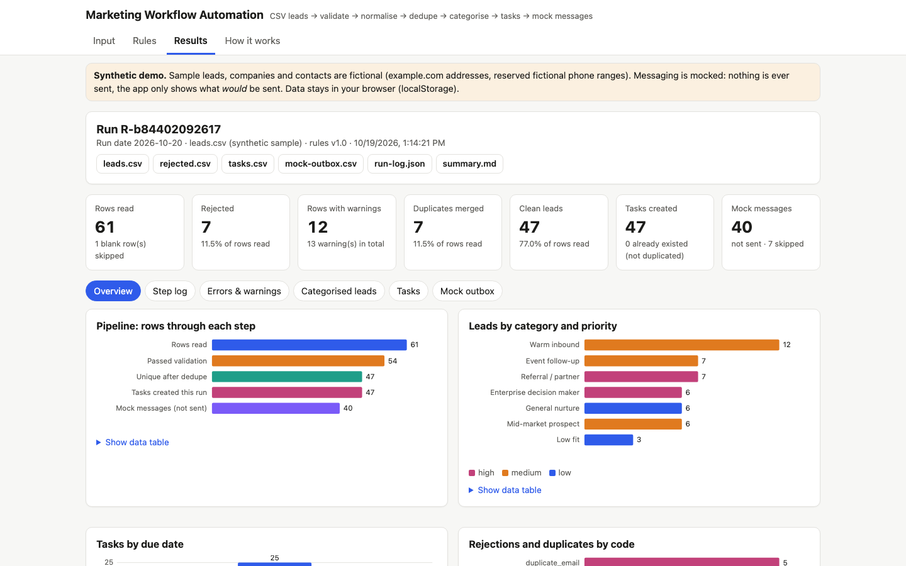

# Marketing Workflow Automation

A reproducible lead-processing workflow: it takes a CSV of leads, validates and normalises them, removes duplicates,
categorises them with editable rules, creates prioritised follow-up tasks with due dates, and logs the messages it
**would** send. The same code runs as a **static web app**, a **Node command-line tool** and an **n8n workflow**.

> **Synthetic data, mock messaging.** All sample leads, companies and contacts are fictional (`example.com`
> addresses, reserved fictional phone ranges). The project contains no sending code: "messages" are only logged
> and written to `mock-outbox.csv` with status `NOT SENT (mock)`.

**Live demo:** https://dash-boop0.github.io/marketing-workflow-automation/
**Source:** https://github.com/Dash-boop0/marketing-workflow-automation



## Why

Lead lists arrive from web forms, events, webinars and LinkedIn exports in inconsistent shapes. Before anyone
follows up, someone has to fix casing and phone formats, drop bad emails, merge duplicates, decide who is a priority
and create tasks, and then the same file gets re-imported and creates the same tasks twice. This project makes
that process explicit, rule-driven, logged and safe to re-run.

## Features

- **Ingest** any CSV (RFC 4180: quotes, commas and line breaks inside quotes, BOM, CRLF), with header aliases
  (`E-mail Address`, `Company Name`, `Lead Source`…).
- **Validate** required fields, email syntax and date formats. Each rule either **rejects** the row or **warns** and
  keeps it, with a stable code ([docs/VALIDATION.md](docs/VALIDATION.md)).
- **Normalise** whitespace, name casing, email case, phone digits with country calling codes, country names → ISO codes,
  source names → a fixed list, opt-in values, company size, dates → `YYYY-MM-DD`.
- **Dedupe** by email, then by first name + last name + company; the survivor is filled from duplicates; any opt-out wins.
- **Categorise** with a configurable rules file (`config/rules.json`): ordered conditions (`all`/`any`/`not`, 15
  operators) → category + priority, first match wins.
- **Follow-up tasks** with due dates offset by priority, optionally skipping weekends.
- **Mock messaging**: per-category templates, opt-in respected, nothing sent.
- **Step log** for every record and step: `step, record_id, result, message, timestamp`.
- **Outputs**: clean leads CSV, rejected rows CSV with reasons (re-importable), tasks CSV, mock outbox CSV, run log
  JSON, human summary (Markdown).
- **Idempotent**: hash-based record/task/message IDs; re-running gives identical files and never duplicates tasks or
  messages ([docs/IDEMPOTENCY.md](docs/IDEMPOTENCY.md)).
- **Web app**: upload/paste CSV or load the sample, JSON rules editor with live validation and a plain-English view,
  KPI tiles, SVG charts with data tables, filterable log/leads/tasks, task board with done-ticks kept across runs,
  downloads, back up/restore/reset. Data stays in the browser (localStorage).
- **CLI** with no dependencies, atomic file writes and clear exit codes.
- **n8n** importable workflow (core nodes only, no credentials) generated from the same code.

## Quick start

Requirements: a modern browser; Node.js 18+ for the CLI and tests (no `npm install` needed – there are no dependencies).

### Web app

macOS / Linux:

```bash
git clone https://github.com/Dash-boop0/marketing-workflow-automation.git
cd marketing-workflow-automation
python3 -m http.server 8000
# open http://localhost:8000
```

Windows (PowerShell):

```powershell
git clone https://github.com/Dash-boop0/marketing-workflow-automation.git
cd marketing-workflow-automation
py -m http.server 8000      # or: npx serve .
# open http://localhost:8000
```

Opening `index.html` directly from disk will not work (browsers block ES modules and `fetch` on `file://`); use
a local server as above.

### Command line

```bash
node cli/run.js --input sample-data/leads.csv --rules config/rules.json --out out/ --today 2026-10-20
```

Windows uses the same command (`node cli\run.js ...` also works). Output:

```
Run R-b84402092617 | run date 2026-10-20 | input leads.csv
  rows read 61, rejected 7, with warnings 12, duplicates merged 7, clean leads 47
  tasks created 47, already existed 0; mock messages logged 40 (NOT sent), skipped 7
  wrote: out/leads.csv, out/rejected.csv, out/tasks.csv, out/mock-outbox.csv, out/summary.md, out/run-log.json
```

| Option | Meaning |
|---|---|
| `--input <file>` | Leads CSV (required) |
| `--rules <file>` | Rules JSON (default `config/rules.json`) |
| `--out <dir>` | Output folder (default `out/`, git-ignored) |
| `--today <YYYY-MM-DD>` | Run date for due dates and lead age (default: today) |
| `--now <ISO timestamp>` | Fixed clock for log timestamps → byte-identical run logs |
| `--existing-tasks <tasks.csv>` | Earlier tasks; same IDs are kept unchanged, not duplicated, not re-messaged |
| `--quiet`, `--help` | |

Exit codes: `0` success · `1` usage/configuration error (bad flag, missing file, invalid rules or date) ·
`2` input error (e.g. missing required columns; details in `out/summary.md`).

npm shortcuts: `npm run demo`, `npm run sample-output` (regenerates `sample-output/`), `npm run build:n8n`, `npm test`.

### n8n

Import `n8n/marketing-workflow.json` and follow [n8n/README.md](n8n/README.md). It was **structure-checked and its
Code node executed with a mocked n8n API, but it has not been run inside n8n.**

## How to use the web app

1. **Input** – *Load sample leads*, choose a CSV file, or paste CSV. Check the preview. Set the run date and the
   options (skip weekends; use the saved task board).
2. **Rules** – edit `rules.json` in place. Errors are shown with their JSON path (e.g.
   `$.categorisation.rules[2].then.priority`) and the workflow will not run until they are fixed.
3. **Run workflow** → **Results**:
   - *Overview*: KPIs and charts; *Step log*: filter by step/result, search;
   - *Errors & warnings*: rejected rows with reasons, warnings on accepted rows;
   - *Categorised leads*: filter by category/priority, search;
   - *Tasks*: tick done (saved), filter; *Mock outbox*: messages that would be sent, and why others were skipped.
4. **Download** any output. **Back up data** exports everything as JSON; **Restore** imports it; **Reset** clears it.

## Rules file

```json
{
  "id": "enterprise-decision-maker",
  "when": { "all": [
    { "field": "company_size", "op": "gte", "value": 1000 },
    { "field": "job_title", "op": "has_any_word", "value": ["chief", "vp", "vice president", "director", "head"] }
  ] },
  "then": { "category": "Enterprise decision maker", "priority": "high" }
}
```

Shipped rules (first match wins): Low fit (students/interns) → Referral / partner → Enterprise decision maker →
Warm inbound (website/webinar/content ≤ 30 days old) → Event follow-up → Mid-market (50–999 employees) → default
*General nurture*. Task offsets: high = Call in 1 business day, medium = personalised email in 3, low = nurture
sequence in 7. Full schema and operators: [docs/VALIDATION.md §6](docs/VALIDATION.md#6-rules-file-checks-configrulesjson).

## Metric definitions

All counts come from one run. Denominator for percentages = **rows read** (non-blank data rows); if it is 0 the
percentage is shown as "n/a".

| Metric | Definition |
|---|---|
| Rows read | Data rows after the header, excluding completely blank rows |
| Rejected | Rows with at least one *reject* rule (each row counted once) |
| Rows with warnings | Accepted rows with at least one warning (`warningsTotal` counts every warning) |
| Duplicates merged | Accepted rows merged into an earlier row (email or name + company) |
| Clean leads | Rows read − rejected − duplicates merged |
| Tasks created | Follow-up tasks inserted this run (one per clean lead unless it already existed) |
| Already existed | Tasks whose ID was already on the task board / in `--existing-tasks` (left unchanged) |
| Mock messages | Messages built for newly created tasks whose lead has an email and opt-in = yes (when required) |
| Messages skipped | Clean leads without a mock message (no email, no opt-in, or task already existed) |

Sample run check: 61 − 7 − 7 = 47 clean leads; 47 − 7 skipped = 40 mock messages. Due dates for run date Tue
2026-10-20 with weekends skipped: high → Wed 21, medium → Fri 23, low → Thu 29 (all hand-checked in the tests).

## Data model and architecture

See [docs/ARCHITECTURE.md](docs/ARCHITECTURE.md) (Mermaid diagram, modules, output schemas, design decisions).

```
index.html, src/app.js, src/styles.css   web app (GitHub Pages, no build step)
src/lib/*.js                             pure shared logic (csv, hash, dates, validate, normalise, dedupe, rules, tasks, outputs, pipeline)
cli/run.js                               command-line workflow
config/rules.json                        categorisation, task and mock-messaging rules
n8n/                                     importable n8n workflow + instructions
scripts/build-n8n.js                     generates the n8n Code node from src/lib
sample-data/                             synthetic leads + template
sample-output/                           outputs from a real CLI run of the sample
docs/                                    architecture, validation rules, idempotency, demo script, screenshot
tests/                                   node:test suites
```

## Sample data

`sample-data/leads.csv` has 61 synthetic leads plus one blank row, deliberately including invalid emails, missing
fields, impossible dates, mixed formats, an extra-field row, a short row, a formula-injection note, and
email/name+company duplicates. Every edge case and its expected result is listed in
[sample-data/README.md](sample-data/README.md). `sample-output/` contains the real output of running it (regenerate
with `npm run sample-output`; a test fails if it drifts).

## Tests

```bash
npm test     # node --test tests/*.test.js, no dependencies
```

83 tests cover: CSV parsing/serialisation and injection protection; SHA-256 against FIPS vectors and `node:crypto`;
date parsing and business-day arithmetic (known calendar cases); every validation code; normalisation; dedupe and
merge rules; every rule operator, first-match order and rules-file validation; task due dates, IDs, merge and mock
message skip reasons; full-pipeline counts on the sample (hand-verified); byte-identical re-runs; no duplicate tasks
or messages on re-run; fatal-error handling; CLI exit codes and files; the committed `sample-output/`; and the n8n
JSON structure plus execution of its Code node with a mocked n8n API.

The web UI was checked with a Playwright script (not part of `npm test`, since it needs a browser): load sample,
run, every results view and filter, downloads identical to `sample-output/`, task done-ticks, idempotent re-run,
reload persistence, rules validation, skip-weekends toggle, CSV upload, back up/reset/restore, fatal error display,
no horizontal scroll at 375 px, dark mode, no console errors and no third-party requests.

## Limitations

- **Mock messaging only.** There is no integration with an email service or CRM; that is deliberate.
- **Email check is syntactic.** It does not verify that domains or mailboxes exist.
- **Dates are day-first** for slash/dot/dash formats (`05/10/2026` = 5 October). US month-first input is rejected as invalid
  rather than guessed. ISO date-times keep the written date (no timezone conversion).
- **Country and source lists are small** (16 countries, 8 source groups) and English-centric; other values produce warnings.
  Phone normalisation is a digit/calling-code heuristic, not full numbering-plan validation (no libphonenumber).
- **Name+company dedupe is exact** after normalisation; it does not catch typos ("Jon" vs "John") or nicknames.
- **Business days skip Saturday/Sunday only**; public holidays are not considered.
- **One follow-up task per lead.** Changing rules does not update existing tasks (insert-if-absent by design).
- **Web app is single-user** and stores data in this browser only; files over 5 MB should use the CLI.
- **n8n workflow not executed in n8n** (see above); node parameters may need adjusting for other n8n versions.
- Record IDs depend on the email: a changed email is treated as a new lead.

## License

MIT – see [LICENSE](LICENSE).

## Repository details

- **Name:** `marketing-workflow-automation`
- **Description:** Lead workflow automation: validate, normalise, dedupe and categorise CSV leads, create follow-up tasks, mock messaging.
- **Topics:** `marketing-automation`, `marketing-operations`, `lead-management`, `data-cleaning`, `deduplication`, `workflow-automation`, `n8n`, `vanilla-javascript`
- **Profile README line:** *Marketing Workflow Automation – rule-driven lead cleaning, dedupe, categorisation and follow-up tasks with an idempotent CLI, web app and n8n workflow (synthetic data, mock messaging).*
