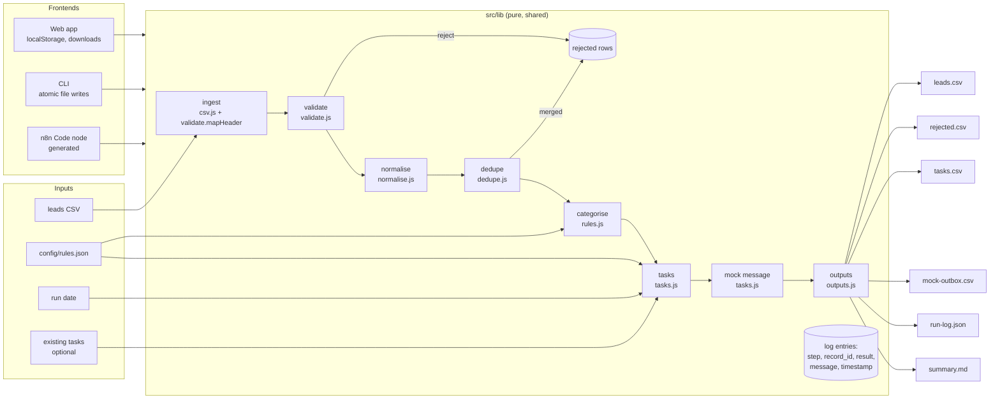

# Architecture

One set of pure functions (`src/lib/*.js`, no DOM, no I/O, no dependencies) is used by three front ends:

- the **static web app** (`index.html` + `src/app.js`), served by GitHub Pages;
- the **Node CLI** (`cli/run.js`), which adds file reading/writing;
- the **n8n workflow** (`n8n/marketing-workflow.json`), whose Code node is generated from the same files by
  `scripts/build-n8n.js`.

## Modules

| File | Responsibility |
|---|---|
| `src/lib/csv.js` | RFC 4180 parser (BOM, CRLF, quotes, embedded newlines) and serializer with formula-injection protection |
| `src/lib/hash.js` | Pure-JS SHA-256 and short IDs |
| `src/lib/dates.js` | Date parsing (accepted formats), business-day arithmetic on UTC day numbers |
| `src/lib/validate.js` | Header alias mapping, email syntax, row validation rules and codes |
| `src/lib/normalise.js` | Text/name/email/phone/country/source/opt-in normalisation, company key, record ID |
| `src/lib/dedupe.js` | Email then name+company duplicate detection and merge |
| `src/lib/rules.js` | Condition evaluation, first-match categorisation, rules-file validation, templates |
| `src/lib/tasks.js` | Task building, due dates, insert-if-absent merge, mock message building |
| `src/lib/outputs.js` | CSV/JSON/Markdown output builders |
| `src/lib/pipeline.js` | Orchestrates the steps and writes the log |
| `src/app.js` | UI: tabs, input, rules editor, results views, charts (inline SVG), persistence, downloads |
| `cli/run.js` | Argument parsing, file I/O, atomic writes, exit codes |
| `scripts/build-n8n.js` | Generates the n8n workflow JSON from `src/lib` and `config/rules.json` |

## Data model

**Lead** (row of `leads.csv`): `record_id, first_name, last_name, email, phone, company, job_title, company_size,
country, source, created_at, opt_in, category, priority, rule_id, task_id, source_rows, warnings, notes`.
`source_rows` lists every input row merged into the lead (e.g. `2;13;31`).

**Rejected row** (`rejected.csv`): `_row, _stage (validate|dedupe), _record_id, _codes, _reasons, _duplicate_of`,
then the original columns with the original values (so the file can be fixed and re-imported).

**Task** (`tasks.csv`): `task_id, record_id, lead_name, company, email, phone, category, priority, task_type,
due_date, owner, status (open|done), rule_id, created_in_run`.

**Mock message** (`mock-outbox.csv`): `message_id, task_id, record_id, to, from, subject, body, template,
status = "NOT SENT (mock)"`.

**Log entry** (`run-log.json → entries[]`): `seq, step (ingest|validate|normalise|dedupe|categorise|tasks|message|output),
record_id (row-N before an ID exists), result (ok|warn|reject|skip|error), message, timestamp`.

## Design decisions

- **Pure core, thin shells.** Everything testable runs in Node without a browser; the UI and CLI only do I/O.
- **Determinism.** The run date and clock are parameters, never read implicitly inside `src/lib`. IDs are hashes,
  sorting is total. See [IDEMPOTENCY.md](IDEMPOTENCY.md).
- **Fail loudly at the edges, softly inside.** Structural problems stop the run; row problems reject or warn with a
  code, so one bad row never blocks the rest.
- **No sending code at all.** "Messaging" builds message objects and logs them. There is no SMTP, HTTP or email
  library anywhere, and the rules validator refuses any messaging mode other than `mock`.
- **Web app persistence.** localStorage key `mwa:v1` holds the CSV text, rules text, run date, task board and the
  last result. Back up/restore uses the same JSON shape (validated on restore).
